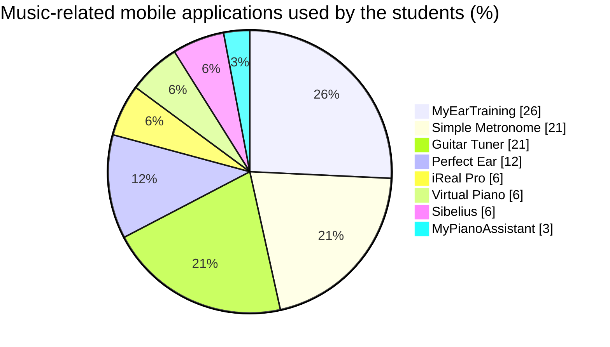
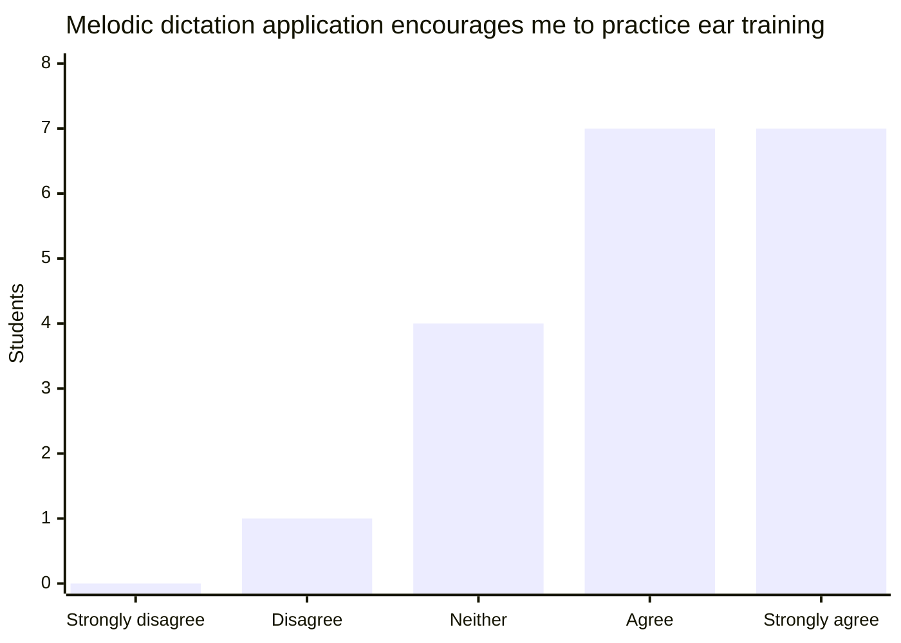
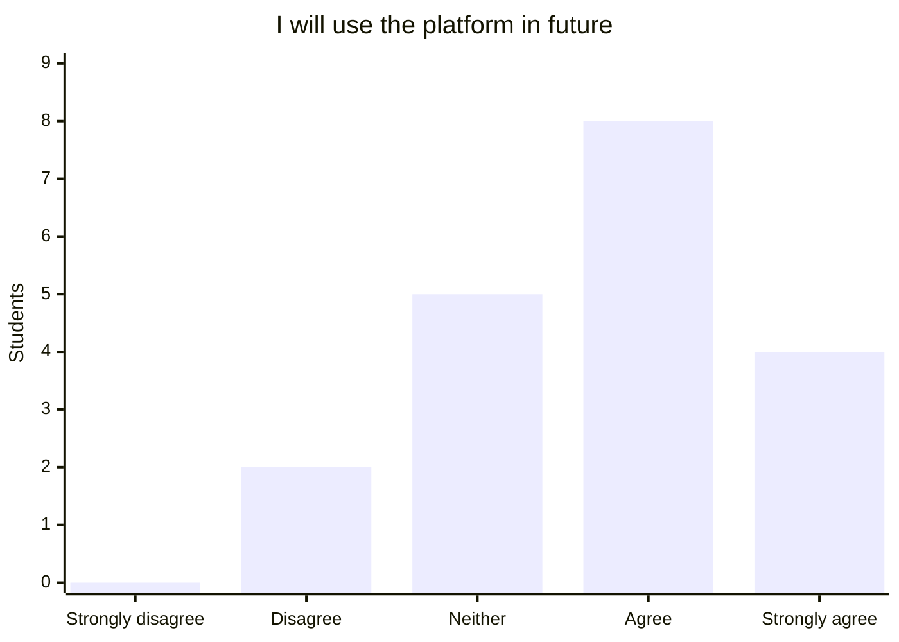
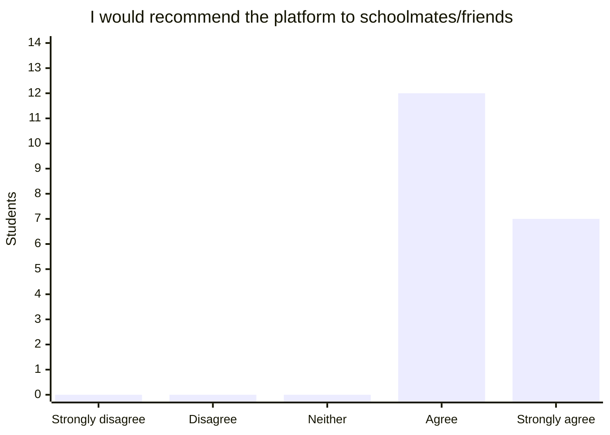
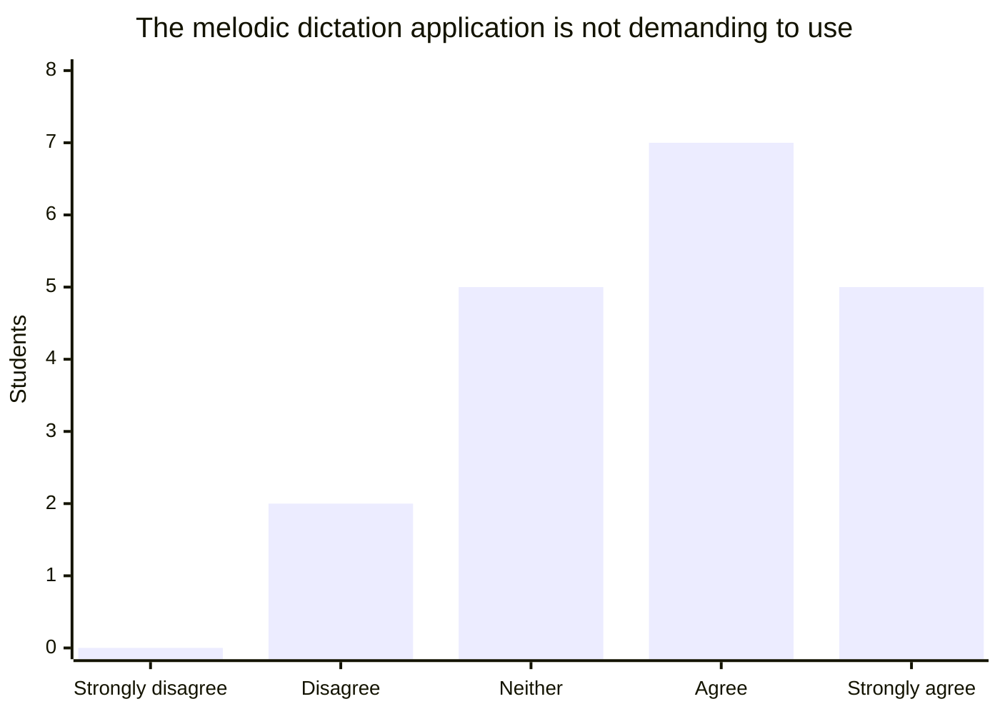
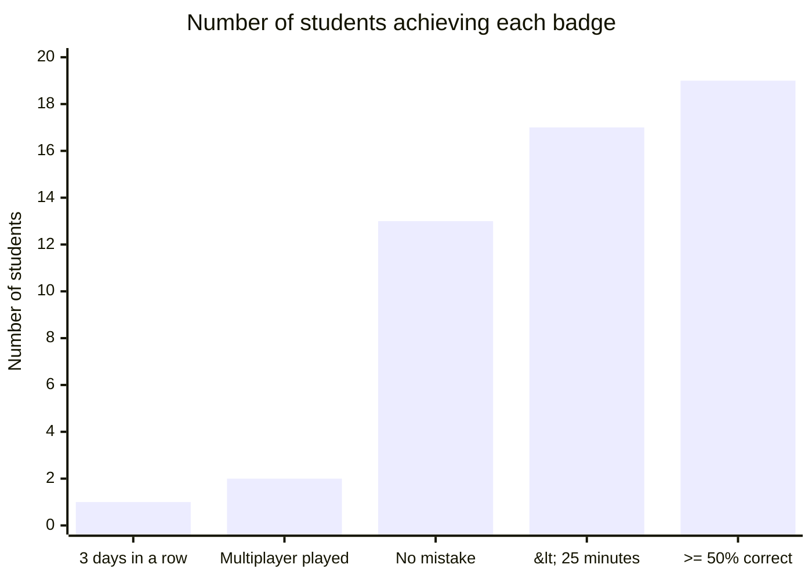
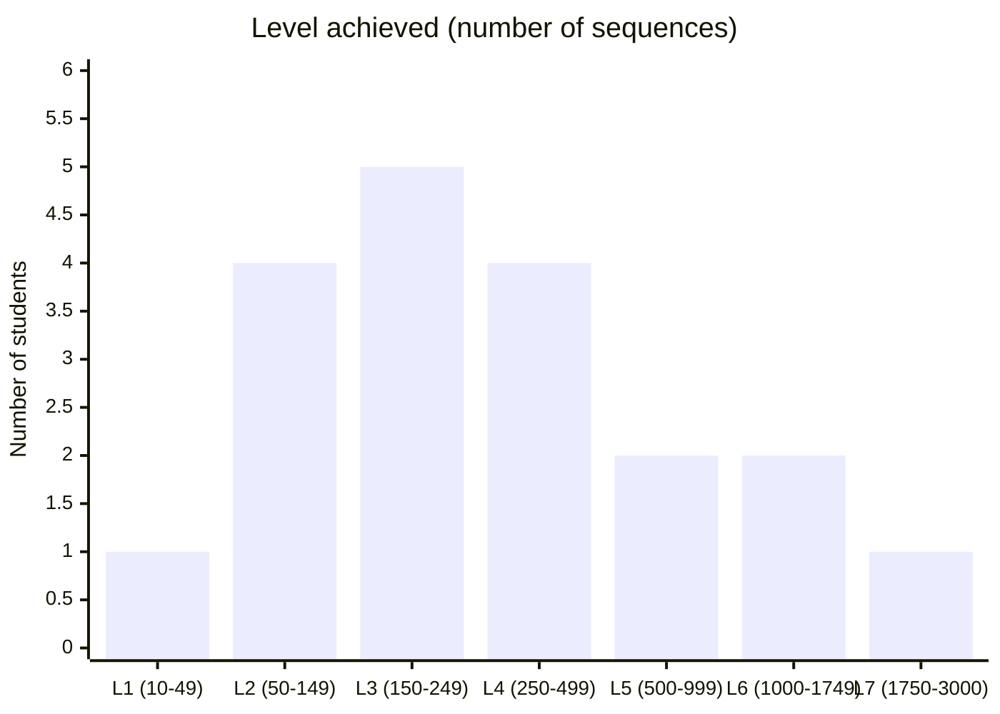

# Troubadour: A Gamified E-learning Platform for Ear Training

Matevž Pesek¹, Žiga Vučko¹, Peter Šavli², Alenka Kavčič¹ and Matija Marolt¹

¹ University of Ljubljana, Faculty of Computer and Information Science (e-mail: firstname.lastname@fri.uni-lj.si)
² Conservatory of Music and Ballet Ljubljana (e-mail: peter.savli@kgbl.si)

Corresponding author: Matevž Pesek (e-mail: matevz.pesek@fri.uni-lj.si).

*IEEE Access, Volume 4, 2016. DOI: 10.1109/ACCESS.2020.2994389. This article has been accepted for publication in a future issue of this journal, but has not been fully edited. Content may change prior to final publication.*

---

## ABSTRACT

Troubadour platform is an open-source personalized and adaptive web platform for ear training. The platform was developed to support music theory classes with automated music-theory-related exercises. In this paper, we present our three-stage development methodology, which incorporated the needs and feedback from both teachers and students to build an engaging music-theory e-learning platform with gamification elements. We developed and evaluated the platform with students of the Conservatory of Music and Ballet Ljubljana. The students of the 1st and 2nd year of the programme were split into two groups—the control group used the traditional way of learning, while the test group augmented their learning with the Troubadour platform. The evaluation results show an increase in exam performance and corroborate the platform's user experience as one of the key reasons for the students' engagement.

**INDEX TERMS:** music theory education, ear training, music information retrieval, gamification, e-learning

---

## I. INTRODUCTION

Music learning takes place in a variety of formal and informal education processes, from elementary and high schools, to specialised music theory and instrument courses. While music brings joy to both performers and listeners, learning music theory and ear training are often a less desirable task among the children and teens who attend music programs. Exercises in music theory and ear training are usually done on paper, while computers or mobile devices are rarely used as a tool for practice. There is therefore room to provide support for music theory practice with suitable information and communication technology (ICT) tools, which would increase the engagement of students and enable them to study more often and outside of the classroom (e.g. at home), with immediate feedback about their performance. In this paper, we focus on e-learning tools in music theory, more specifically the development of an open-source platform, which includes gamified ear training applications.

Of course, ICT tools are already used to support classes, most often the support is given through various learning management systems (LMS). Teachers use the LMS to maintain two important aspects of their interaction with the students—the management of the learning materials, and increasing student engagement through assignments and exercises, which are sometimes gamified.

### A. LEARNING TOOLS

LMS platforms allow teachers to easily distribute learning materials to their students. The quality of the materials can vary depending on the amount of available time and LMS-related knowledge of the individual teacher [1]. For music theory, several topic-specific packages were built for use in LMS. For example, Carney [2] built a system for music theory learning in the piano classroom with SCORM packages for the Moodle LMS, which is one of the most commonly used systems [3], [4]. The packages included a user interface built with Adobe Flash technology and while music theory specific widgets (piano keyboard) are supported, the integration with the underlying LMS is limited and the technology used has become obsolete in recent years. Consequently, updating and maintaining the packages would require expert knowledge by the teacher, and access to the source code.

Creating and maintaining digital materials demands time and ICT skills. To reduce the teachers' workload, part of the content (i.e. randomised exercises) can be automatically generated (e.g. [5], [6]). While plugins that offer automatic generation of exercises within existing LMS exist (e.g. Music Theory, Music Scale, and Music Key Signature plugins for Moodle¹, these plugins require considerable input from the teacher in order to prepare the exercises. Several projects are focused on the development of a LMS with automatic assessment, mostly for technology-related topics (e.g. [7]–[10]). The goal of these tools is to lower the teachers' workload and increase the students' engagement. However, previous research [11], [12] has shown that the lack of technical support and computer self-efficacy could prevented the full adoption of the LMS by the teachers, as well as the students [13]. Thus, in non-technology-related classes, the potential for developing gamified learning tools is higher than in technology-related classes, due to the discrepancy in computer self-efficacy amongst the teachers of these classes. With automatic generation of gamified exercises, the teachers' workload could be lowered to match their efficacy.

In the music learning domain, several commercial web and mobile applications are available, which constructively engage in interactive teaching and practice. These applications vary in several directions: instrument-related applications (e.g. My Piano Assistant², Yousician³) and music accompaniment software (e.g. iReal Pro⁴) to music-theory platforms (e.g. theoria.com, musictheory.net, Musition⁵). While automatic generation of exercises supported by some of these applications lowers the teachers' workload with exercise preparation, the usage of these platforms remains limited by the inability of the teachers to adjust exercises to the course plan. Additionally, only a few implement modules for creation of student groups and monitoring their progress. Moreover, these are commercial platforms and therefore not necessarily adaptable to the teachers' needs, and not necessarily affordable to all parties (e.g. public music schools).

### B. GAMIFICATION

Current research shows that games are generally no longer regarded as something negative or obscure in the learning process, but rather as an important impetus to learning [14]–[16]. Many gamification approaches are thus used in e-learning [17], [18], as well as in other areas, such as business and health-care applications [19]. In research, evaluation of gamification [20], [21] and student engagement [22] has received significant attention, and the development of specialised platforms and apps for e-learning has flourished [23].

Al-Othman et al. [24] report on several cases in which specialised learning tools, such as learning platforms, serious games, and game-aided environments were used to improve the learning outcome and increase students' engagement. Cheng et al. [25] performed an overview of related work describing the use of serious games in science education from 2002 to 2013 and proposed a methodology in which the game, pedagogy and research methods are analyzed. Due to the users' enjoyment, serious games are generally perceived as an effective and powerful tool for science learning. Connolly et al. [26] reviewed a broader spectrum of games in research, such as language, history, self-help and socially-oriented games (homelessness, driving, urban planning and others), to determine potential positive impacts and outcomes of regular and serious games with respect to learning and engagement. They also stressed the importance of future serious games development beyond simple puzzle games, and the integration of the serious games into the student's learning process.

Chou [27] proposed a complete gamification framework. The framework encompasses all aspects of gamification through an octagon shape structure with 8 Core Drives representing each side. The author proposed the human-focused design as an alternative term for gamification, that optimizes for human motivation in a system, as opposed to function-focused design.

### C. MOTIVATION

While some of the existing solutions offer gamification of music theory learning and ear training, most of them cannot be easily adapted by the teacher to be used as part of the school curriculum. Most of the solutions are also closed-source, and only a few support automatic generation of exercises. The lack of an adaptive, engaging and open-source solution for ear training and music theory learning has lead us to develop the Troubadour platform. To gain and obtain students' engagement, gamification elements, which have proven to aid this goal, were included.

To lower the teachers' workload, the platform also offers automatic generation of exercises, which can be further adjusted by teachers. It is a web-based platform with a responsive interface that adjusts its layout to different mobile devices. Based on the individual student's exam results, the exercises can be further adjusted specifically to improve the individual student's performance. Currently focused on musical dictation, the Troubadour platform offers an intuitive visual representation of the music score. With gamification features—including badges, leaderboards and a multiplayer mode—the Troubadour platform aims to engage the students in exercising and boosting their skills. The platform therefore represents a student-engaging learning environment for musical dictation, supplementing existing learning management systems, such as Moodle. To support further development of the platform, the code is publicly available for researchers and developers⁶.

In this paper, we report on the development process and the features of the Troubadour platform focusing on user experience and gamification during the development. The platform was developed iteratively in continuous collaboration with music theory teachers and students, in order to maximize the support for the first, and engagement for the latter. Engagement is not the only goal we were pursuing with the development. An important aspect of the e-learning platforms is student performance. We analyze the students' performance through exam grades and compare them with a control group of students. In our analysis, we focused on three important aspects: the user experience, the students' engagement, and the improvement of students' performance. We discuss the gathered and analyzed students' results and mark future steps for improving and extending the Troubadour platform.

The structure of the paper is as follows: we present the methodology of the development and evaluation in Section 2. In Section 3, we provide a detailed report on the development process, and in Section 4 present the platform and its features. The latter is followed by the analysis of actively and passively gathered platform data in Section 5. We conclude this paper with Section 6, where we also deliberate on the ongoing development of new features and improved automation of exercise generation.

---

¹ https://moodle.org/plugins/index.php?q=music
² Available on Google Play and Apple App store
³ https://yousician.com
⁴ https://irealpro.com/
⁵ https://www.risingsoftware.com/musition
⁶ https://bitbucket.org/ul-fri-lgm/troubadour_production

---

## II. METHODOLOGY

The primary goal of this work was to provide an open-source platform, which would engage students and increase their performance in dictation tasks. To gain the students' engagement, the platform included several gamification elements and an intuitive interface on mobile devices. In this section, we first outline the methodology of the platform's development, which is based on previous well-accepted methodology, which maximizes the chance of developing an engaging tool through human-oriented development. Later, we outline the envisioned hypotheses and provide a methodology of evaluating the anticipated goals.

### A. DEVELOPMENT PLAN

Our methodology for the development of the Troubadour platform was based on a shortened version of the iterative approach, described by McAllister and White [28]. They split the video games development into two sets of phases: the pre-production and prototype phases, and the implementation and testing phases. In the first set of phases, the following methods and approaches are used:

- Focus groups
- Interviews
- Informal play testing
- Questionnaires

We adopted this methodology of development and formed the Troubadour platform development plan. We split the development into three stages to achieve continuous evaluation and adaptation of the platform. During the first stage, we performed preliminary interviews with teachers about the desired features of the new platform, as well as preliminary interviews with students about their engagement with mobile devices, specifically mobile games and music-related applications (profiling the target audience).

In the second stage, we developed a prototype of the platform and an interval dictation application. We acquired user experience feedback through questionnaires and by analyzing the user activity data. The gathered data was used to adapt the user interface, in order to reduce frustrations and improve the user experience. We modified the prototype according to the observed users' behaviour, specifically ways of interaction with the prototype, their workflows, interactions and frustrations. Additionally, a second round of interviews was conducted with the students about their experience with the prototype (difficulty, gamification aspects, frustration).

In the third stage, we developed the final platform, taking observations from the second stage into account. We presented the platform to the students and teachers at the conservatory. The students and the teachers began using the platform in their music theory courses. During this period, we collected data on the use of the platform, both in class and at home, tracked users' performance in exercises within the platform and their interactions with the platform. We also gathered data on students' performance on the course exams, which were prepared by the teachers.

### B. GOALS OF EVALUATION

The primary goal of the development reported in this article was to provide an open platform, which would engage students and increase their performance in interval dictation tasks. The interval dictation application was tailored to increase student engagement through gamification elements and an intuitive interface on mobile devices. In our experiment, we wanted to assess whether these goals were achieved.

Before performing the experiment, several hypotheses were envisioned. First, we assumed the mobile-friendly interface would enable students to engage with the application. While the students might spend more time within individual exercises at the beginning to adjust to the interface, the time spent would eventually decrease due to the adjustment and, considering the exercises within a single level, due to their increasing proficiency. Second, we hypothesized that student engagement would have an impact on their performance, which we measured in this experiment.

As the platform represents a digital medium for ear training, the students' adoption to a new learning platform was necessary. To aid the adoption of the platform, we included several gamification elements in the platform. We evaluated the students' user experience through questionnaires, focusing on gamification elements and gathering information about possible improvements of the platform. Additionally, to evaluate the students' engagement with the platform, we collected questionnaire responses from the test student groups using the platform. We also analyzed the collected interval dictation application data, such as achieved levels and badges, and number of points collected per exercise. Finally, we evaluated the platform's effectiveness in terms of its impact on the students' performance. We conducted an A/B testing with the control and test student groups and compared results of a conventional exam.

---

## III. DEVELOPMENT OF THE PLATFORM

In this section, we report on the individual stages of the development plan described in the methodology.

### A. STAGE 1: PRELIMINARY INTERVIEWS AND QUESTIONNAIRES

Before starting the development, we analyzed the end users' needs. Our two target user groups consisted of conservatory students and their teachers. The teachers recognised the need for the platform from their in-class experience. Their observations were mostly based on the limitations of the existing Moodle LMS used at the conservatory. On the other hand, the platform needed yet to engage students. For this user group, we explored their engagement with mobile devices, mobile games and music-related applications.

#### 1) Teacher's point of view

We first gathered the desired features of the Troubadour platform by interviewing the teachers. Their first requirement was that the platform should be usable during music theory courses in classrooms without additional equipment, as well as by students at home. Additionally, the teachers wished to oversee the students' progress, adjust the parameters for exercise generation and administer student accounts on a desktop computer. Therefore, we opted for the development of a responsive web platform that would adapt to both desktop and mobile devices and would not need additional installation procedures. With the existing tools, the teachers could not generate exercises and homework with music related materials, due to their lack of technical skills. The user interface should therefore not require advanced ICT skills. Moreover, the teachers requested to observe the different types of mistakes the students made and they also proposed to gather more information about the individual student's problems while solving the exercises.

#### 2) Student's point of view

To develop an application that would be suitable for music theory students, we gathered information on their behaviour through questionnaires. We focused on three aspects of their everyday use of mobile devices: their general sophistication with mobile devices (time spent and purpose of use), the use of music-related applications (music streaming, sheet music writing, composing) and experience with playing games. The questions are shown in Table 1.

**TABLE 1:** The student questionnaire 1. The questionnaire was given to the students in Slovenian language. The questions in the table are shortened to an informative description.

| # | Question |
|---|----------|
| 1 | Age of student |
| 2 | List and frequency of use of PC/consoles in hours per day |
| 3 | List and frequency of use of music-related mobile apps in hours per day |
| 4 | Brand and model of the student's mobile phone |
| 5 | Name of the web browser they most frequently use on the mobile phone (Chrome / Safari / Firefox / other) |

The third question in questionnaire 1 indicated whether a mobile device represented an everyday medium for interaction. Additionally, the self-evaluation of time spent on a mobile device provided a benchmark about the time spent using the Troubadour platform we measured later in the third stage of the platform development.

The students' responses clarified the general opinion that the gamification of the music-related exercises would motivate the students to spend extra time with the platform. We therefore focused on the gamification of the exercises as the main leverage for gaining the engagement of the students.

### B. STAGE 2: PROTOTYPE DEVELOPMENT AND EVALUATION

During the second stage, we developed a prototype of the Troubadour platform. The prototype included modules for user administration and tracking, and ear training interval dictation application for practicing melodic intervals. The automatic generation of exercises was also developed and included in the platform. The automatic generation produced exercises distributed into four levels. The difficulty of these levels corresponded to the conservatory semesters, and each was subdivided into additional four difficulty (sub)levels. The exercises also supported several gamification elements, such as badges and leaderboard views.

In this study, we focused on evaluating the interval dictation application to evaluate the effectiveness of the platform. The application screen is shown in Figure 1. Within the application, the student can play interval dictation exercises. An exercise consists of five melodic sequences, which need to be answered. Each melodic sequence is first played to the student and its first note is displayed in staff notation. The student's task is to recognize the heard notes and input them into the displayed music notation. The student can enter their response by clicking on the piano keyboard displayed below the staff.

*[FIGURE 1: The prototype interval dictation application game screen. The screen adapts to mobile device orientation. (a) Portrait view; (b) Landscape view. — Screenshot, not reproduced.]*

As the game progresses, the number of notes and the difficulty of dictation increases, depending on the student's performance. Primarily, the range of individual intervals—two consecutive melodic events in the melodic sequence—increases. With the increased difficulty, the generated sequences include more specific intervals (tritone, chromatic progressions) intervals in alternating directions, more partial consonances than pure consonances and more dissonances than consonances.

To achieve a new level, the student needs to complete a number of exercises (2 exercises for level 1, 10 for level 2, 50 for level 3, 50 for level 4, 100 for level 5, 200 for level 6, 350 for level 7, 500 for level 8 and so on). If an answer is incorrect, the student can correct their response and retry the submission. The number of attempts was unlimited in the prototype application. The response time to a single melodic sequence was limited to two minutes. The user interface of the prototype application was adjusted to the mobile device orientation—in portrait, the control buttons were placed below the keyboard, while in the landscape mode, the controls were placed to the right of the staff view.

We evaluated the prototype in terms of user experience and automatic generation of exercises. The evaluation of the prototype was repeated twice [29]. During this stage, the prototype was first given to two students who engaged with the interval dictation application. We passively observed their behaviour and tracked any potential frustrations with the interface. The students were given the following tasks to complete using the app:

1. Log into the platform
2. Open your profile and check the data
3. Go to the home screen
4. Check your score on the ranking view
5. Go to settings and change the playing instrument
6. Adjust the pause between individual events in the application settings
7. Log out
8. Register using a new email address, confirm the registration and log in
9. Rotate the device into landscape orientation and open individual modules
10. Choose the interval dictation application and read the instructions
11. Complete one exercise in the interval dictation application

After completing the tasks, the students were given a detailed questionnaire. The questionnaire was divided into 3 sections: user-oriented, technical and pedagogical. The user-oriented questions were related to the user experience of using the application and the appearance of the user interface; the technical questions gathered information regarding the application's performance and responsiveness; questions from the pedagogical sections addressed the learning aspects of the platform's use. The questionnaire is shown in Table 2.

**TABLE 2:** The student questionnaire 2. The questionnaire was given to the students in the Slovenian language. The questions in the Table are shortened to an informative description. Possible responses to questions 1–24 were: I agree completely, I somewhat agree, I neither agree nor disagree, I somewhat disagree, I completely disagree. Questions 25 and 26 were open-ended. The questionnaire was used during the second stage (prototyping), and also during the third stage of development.

| # | Question |
|---|----------|
| 1 | Using the platform was not difficult |
| 2 | Instructions were clear and helpful |
| 3 | I did not need instructions to use the app |
| 4 | The platform was responsive (there were no time delays) |
| 5 | I did not have enough time to solve individual exercises |
| 6 | I would need more time to learn how to use platform |
| 7 | The interval dictation application encouraged me to perform ear training |
| 8 | I sometimes felt frustrated |
| 9 | I would recommend the platform to my classmates |
| 10 | I would rather use the platform if there were more different exercise types |
| 11 | The platform had a sufficient amount of different exercise types |
| 12 | The interval dictation application was difficult to play |
| 13 | The interval dictation application was fun to play |
| 14 | I will continue to use the platform |
| 15 | I liked the appearance of the platform |
| 16 | The arrangement of the platform into different views was not useful |
| 17 | The user interface (piano roll, music sheet, buttons) were useful |
| 18 | I had problems navigating through the platform |
| 19 | I quickly found the information I was looking for |
| 20 | I had problems with setting up the platform (filling in information in the user profile) |
| 21 | I was driven to get more badges and complete more levels while solving exercises |
| 22 | I liked the ranking view with my and others' scores |
| 23 | I did not like that other users could see my score on the ranking view |
| 24 | I would rather use the interval dictation application if it had a multiplayer mode |
| 25 | How often did you use the application at home (h/week)? |
| 26 | Do you have any additional comments? |

In their responses to the questionnaire 2, the students pointed out that the exercises in the interval dictation application were not too demanding. They welcomed the fact, that if an individual sequence is too difficult, it could be solved by replaying and retrying. They also wished for more different game modes and more additional exercise types. They stressed that the interval dictation application would be a better way of learning interval dictation than the conventional way of listening to pre-recorded sequences and writing the dictation on a music sheet. They also stated that they would use the application for practice before the test.

The main complaints the students had was the low sound quality of the synthesized instruments that played the interval sequences and the brevity of the pause between the intervals. They pointed out the usefulness of the piano keyboard as the means for entering notes, and for them also as an additional practicing tool for learning piano key mappings, because the piano was not their primary instrument. They also expressed suggestions with regards to the keyboard size, which was too small on smaller interfaces. The students expressed the need for additional information about the number of notes in the sequence for each exercise. They would also welcome the opportunity to manually adjust exercise settings during a game, thus quickly switching between different difficulties. Finally, one of the students suggested that they would like to have the possibility of stopping the playback in the middle of the melodic sequence.

Based on the questionnaire responses, we revised the landscape layout of the application and added a home button to the menu. We also improved the piano keyboard size to fit the student requests and added the button to show the instructions also during exercising, as opposed to the original implementation, which only showed the instructions at the beginning of the exercise. Based on passive observations, we limited the number of answer re-tries to a range between 2 and 5 (depending on the difficulty of the game). We addressed the poor sound quality of the instruments with better sound samples and extended the longest possible pause between the tones played. We also implemented the option to stop the playback of the melodic sequence according to the students' proposal.

### C. STAGE 3: INTEGRATION OF THE PLATFORM INTO MUSIC THEORY COURSES

During the third stage, we deployed the platform on a publicly-accessible web server⁷. We tested the platform with the first- and the second-year students at the conservatory. In both classes, we split the students into two groups: a test group and a control group. The latter was used to compare the results of the final exam in the music theory courses. The students in the test groups used the platform twice during the class and were allowed to use the platform at home without any time restrictions or obligations.

After one month of the platform's use in class, the two test groups were given the questionnaire 2, shown in Table 2. The two control groups were given a different questionnaire (shown in Table 3) about their everyday dictation exercises, which they did in a conventional way (playing the pre-recorded exercises and solving them on paper). All of the students of both control and test groups were also given a final exam at the end of the music theory course, which was part of their regular curriculum. We compared the results of students within the individual classes.

**TABLE 3:** The student questionnaire 3 for students of the control groups. The questionnaire was given to the students in the Slovenian language. The questions in the Table are shortened to an informative description.

| # | Question |
|---|----------|
| 1 | Age of student |
| 2 | Amount of time spent (weekly) on exercising interval dictation in the conventional way (using recordings or an instrument) |
| 3 | Would you use a game/app for exercising ear training, if it were available for your class? |

---

⁷ Available at https://trubadur.si

---

## IV. THE TROUBADOUR PLATFORM

In this section, we present more details on the Troubadour platform. The platform was developed as a responsive web application, which adapts well to mobile devices. In this way, we simplified the development and maintenance of the platform, as we do not have to support each popular operating system separately (e.g. Windows, Linux, OS X, Android, iOS and others).

### A. TECHNICAL DETAILS

The server side of the platform was implemented using the PHP programming language and its Laravel framework. The server communicates with a MySQL database, using object-relational mapping between the database and the Laravel framework models to facilitate the development. The front-end is divided into two parts: the first deals with registration and authentication, and uses the Laravel Framework Blade templates, while the second includes the exercise and gamification automation logic and is implemented with Vue.js and its associated component system, router, and status management system. All communication with the web server after authentication and initialization of the basic component of the Vue.js framework is done via asynchronous web requests to the API server, which returns data in the JSON format.

For consistent rendering of the user interface we used the Axios, Lodash, Moment.js, node-sass and BEM notation libraries. The environment was set-up for lean and simple scalability in both technical and content-related aspects. For example, adding a new application to the platform only requires adding a new Vue component on the client (vue.js) side and the logic of the specific controllers on the server (Laravel) side.

The Troubadour platform is easily deployable with the use of package management tools (NPM and Composer). It is available as open source software and publicly accessible on Bitbucket⁸.

### B. THE INTERVAL DICTATION APPLICATION

We evaluated the usability of the platform with an application for practising interval dictation. The application's aim is to improve the interval recognition skills of the students.

The student can access the application by clicking on a button on the home screen, or choosing from a list of applications on the side menu. After choosing the application, the student is redirected to the initial game screen, where they can choose between practice, single-player and multi-player modes.

When playing for practice, the answers are not counted towards the student's position in the ranking system, since the practice mode is intended for learning rather than competition. The presented exercises in the interval dictation application are adjusted according to the student's selection of the course (music school, first–fourth conservatory year, academia). The difficulty of the exercises was defined in consultation with the teachers and varies in interval range and the number of notes in each melodic sequence. The individual ranges are shown in Table 4.

Within each difficulty level, the generated exercises increase in difficulty during gameplay by changing the frequencies of difficult intervals. The time for solving an individual sequence is limited to two minutes. During this time, the student can re-play the sequence at any moment. If the student does not correctly answer within the two minute time-span, a new sequence is generated. The student can respond a limited amount of times for an individual sequence (2–5), depending on the set difficulty.

**TABLE 4:** Exercise difficulty levels for the interval dictation application, depending on the selected school/year

| School level | Year | Semitone range | # notes in seq. |
|--------------|------|----------------|-----------------|
| music school | all years | 3 | 2–4 |
| conservatory | 1. | 5 | 4–6 |
| conservatory | 2. | 12 | 4–6 |
| conservatory | 3. | 12 | 6–8 |
| conservatory | 4. | 12 | 6–8 |
| academia | all years | 12 | 6–8 |

### C. MAXIMIZING THE FLEXIBILITY OF THE PLATFORM

#### 1) Automatic generation of exercises

The generation of meaningful pseudo-random melodic sequences is a non-trivial process. We developed a sequence generation algorithm, which considers several aspects of sequence complexity: the length of sequence, the size of intervals, and the frequency of interval occurrences.

With the help of the teachers, we analyzed their existing materials and created the initial distributions of interval occurrences for the different difficulty levels. Knowing the interval distributions is necessary for the pseudo-random exercises generation, in order to achieve their varying difficulty, but also to make the exercises meaningful. Using just random sequences would not "make sense" musically, for example, if the unison interval would be present in the output sequence with the same frequency as other intervals (e.g. a minor third), the output sequence would be random, but not meaningful, as such combinations would seldom occur in music. The gathered interval distributions were incorporated as the default values for the melodic sequence generation algorithm. To retain the flexibility of the platform, we implemented an interface for modification of these values, to fit the individual teacher's needs. The output of the sequence generation algorithm is a melodic sequence, governed by the imposed limitations on the the sequence length, the interval size and the interval distributions.

#### 2) Gamification elements

To increase the students' motivation for using the Troubadour platform, we enriched it with gamification elements. While using the platform, students earn points by using the interval dictation application, which directly affects their position on the leaderboard and motivates them to reach higher levels. At the end of each task in an exercise (a melodic sequence for the interval dictation application), a score is calculated (either positive or negative). The calculation takes into account the difficulty of the task (in the case of intervals we take into account the range of intervals and the number of notes), the time it takes to answer, the number of notes added and deleted (penalizes random trying) and whether the student answered the question correctly (the number of attempts for each melodic sequence depends on the level of difficulty that the student indirectly selected through the choice of school and class or year, but never exceeds 5). The ranges for individual factors are represented in Table 5.

**TABLE 5:** Individual factors which are multiplied together to obtain the score for an individual melodic sequence.

| Factor type | Factor range | Calculation of factor |
|-------------|--------------|-----------------------|
| No. of notes | 4–8 | 1 (4 notes), 1.25 (5 notes), 1.5 (6 notes), 1.75 (7 notes), 2 (8 notes) |
| Semitone range | 1–12 | 1 (<= 5 semitones), 1.25 (6–9 semitones), 1.5 (>9 semitones) |
| Correctness | Yes/No | 1 (correct answer), -0.75 (incorrect answer) |
| Additions & deletions | 0.1–3 | n = additions + deletions - notes: 2 (n <= 2), 1.5 (n = [3–5]), 1 (n = [6–9]), 0.75 (n = [10–12]), 0.33 (n = [13–16]), 0.1 (n > 16) |
| Time | 0 − 120 | 3 (n < 20 sec), 2.5 (n = [20, 25 sec]), 2 (n = [25, 30 sec]), 1.5 (n = [30, 40 sec]), 1 (n = [40, 60 sec]), 0.5 (n = [60, 80 sec]), 0.1 (n > 80 sec) |

The gamification elements are visible on the Troubadour's home page, where students can browse through their achievements, as seen in Figures 2a and 2b. In their profile, students can observe and also change their profile picture, username, institution and school year, and see a graphical representation of the collected points, achieved levels and up to three last collected badges. The achieved levels were defined by the teachers, and vary from local orchestra, to different competitions and international institutions. The teachers can observe and analyze the student performance in their administration panel, shown in Figure 3.

*[FIGURE 2: Gamification elements in the platform. (a) Gamification levels; (b) Gamification badges. The left screen shows the path through the different levels (e.g. Level 5: Concert at the National Hall; Level 10: Concert with the New York Philharmonic Orchestra; Level 15: Recording at the Abbey Road Studios), while the right screen shows the badges obtained during learning. — Screenshots, not reproduced.]*

*[FIGURE 3: The teacher's administration panel showing an overview of the students' performance and engagement. — Screenshot, not reproduced.]*

The badges reflect three different aspects of gameplay. The first aspect is accuracy: completing an exercise with(out) a certain amount of mistakes (from 50% up to 100% correct answers). The second aspect is the continuity of the student's engagement with the platform: playing an exercise for a certain amount of days in a row—3 days, 5 days, a week, two weeks, a month. The third aspect is the student's speed: the amount of time needed to complete an exercise in 5 minute intervals, ranging from 25 minutes to 5 minutes.

As an additional element of gamification, we implemented a leaderboard. The students can observe their performance and compare it to other players. By clicking on one of the platform's players, the selected player's profile page is displayed, with their achieved levels and badges. The interval dictation application can be played in multiplayer mode where two or more players play a single exercise (all players are given the same melodic sequences).

---

⁸ https://bitbucket.org/ul-fri-lgm/troubadour_production

---

## V. ANALYSIS

In this section, we first report on the students who participated in the experiment. We then continue with the analysis of the questionnaires used during the development (Subsections B and C), where we analyze the user experience and the students' self-reports on current and future engagement. We also observe the self-report on the automatic exercise generation and exercise difficulty to identify its impact on the students' engagement. We then describe the gathered server-side data and analyze the students' engagement process (Subsection D). Finally, we report on the A/B test in students' performance (Subsection E).

### A. EXPERIMENTAL SETUP

Our study was carried out with the help of first- and second-year students at the Conservatory of Music and Ballet Ljubljana, and their teachers. In teachers' experience, these two classes tend to have most difficulties to adapt to the increased workload and complexity when entering the conservatory study, since the lower music education institutions vary in difficulty. Pending the platform's effectiveness, the interval dictation application could offer an engaging environment to adapt to the increased difficulty at the conservatory level by improving their performance in a non-frustrating way of practice.

Students actively used the platform for one month during lessons and at home, followed by an exam that assessed their performance on interval recognition. Before starting with our experiment, students of both groups answered the questionnaire 1 (Table 1). The students in the test groups were also given questionnaire 2 (Table 2), while the students in the control groups responded to the questionnaire 3 (Table 3).

There were 6 first-year students in the test group and 5 in the control group. For the second-year class, there were 13 students in the test group and 9 in the control group. In summary, there were 19 students in the combined test group and 14 students in the combined control group. In the following subsection, we present an analysis of questionnaire responses in both groups, and compare their performance in the interval dictation exam.

### B. QUESTIONNAIRE 1 RESPONSES

During the first stage, the students in both groups responded to the questionnaire 1. With this questionnaire, we explored if the students are adept to the use of mobile applications and what implications this might have on the use of our platform. We also gathered information about the mobile devices and mobile browsers used by the students, to properly test the responsiveness and adaptiveness of the platform.

Results show that the majority of students used Huawei (34 %), Samsung (24 %) and iPhone (27%) devices, with smaller (iPhone 5s, SE and similar) or larger screens. When designing the platform's user interface, we considered the limitations of the smaller screens and sized the user interface (UI) elements appropriately. The mobile browser distribution shows that a large proportion of the students used the Chrome mobile browser (65 %) followed by Safari (19 %) and Mozilla Firefox (16 %). During the development, we tested the platform on all three browsers.

Most students use social networking apps (Facebook, Instagram, Twitter and similar), with low engagement as the majority stated that they used them rarely. They also use music-related apps, especially MyEarTraining, Perfect Ear, Simple Metronone and Guitar Tuner (Figure 4). The first two are used for music learning/training, while the Simple metronome and Guitar Tuner are used in instrument learning. Interestingly, ten students stated they did not use any music-related apps.

**FIGURE 4:** Music-related mobile applications used by the students. (Share of apps, in %; the original is a two-ring chart that also splits each app's users into "frequently" / "rarely" — e.g. Simple Metronome 29% frequently / 71% rarely; MyEarTraining 33% rarely / 66% frequently; Guitar Tuner 71% frequently / 29% rarely; Perfect Ear 100% frequently; iReal Pro 100% frequently; Virtual Piano 50% / 50%; Sibelius 50% / 50%; MyPianoAssistant 100% frequently.)

### C. QUESTIONNAIRE 2 RESPONSES

The students in the test groups used the platform twice in class during this study. They were also given access to the platform for out of class use, with no specific usage restrictions or encouragements. After the second in-class use of the platform, the students were asked to respond to the questionnaire 2 (Table 2).

#### 1) Application's appearance

In general, the students liked the user interface and the appearance of the platform. The majority of students also found the interval dictation application useful. The navigation through the platform was intuitive and the students reported they can quickly find the relevant information. With regard to the gamification aspects (gaining badges), the students generally remained undecided.

Interestingly, many students did not approve of the public ranking of their performance. However, the students liked the scoring system and the competition the ranking has brought to the platform. To rephrase: the students liked to see they performed better than others, but they did not approve of their scores to be public. The students were undecided regarding the need for a multi-player mode of the game—this functionality is available in the platform, but was not evaluated in this study.

#### 2) Students' self-report on engagement

Generally, the students felt the instructions were helpful, and they also did not feel any time pressure due to the time limitations within the interval dictation application.

The students identified the interval dictation application as an encouragement for interval dictation practice (shown in Figure 5). The majority of students confirmed that they will use the platform in the future, as shown in Figure 6. They would also strongly recommend the platform to their colleagues (Figure 7). Additionally, the students expressed the need for additional exercises for ear training and music theory, as they felt they would further engage them to spend time on the platform. During the evaluation, only the interval dictation application was shown to the students, other applications were not visible on their platform accounts. Generally, the students had fun during their interaction with the platform, and they found the interval dictation application sufficiently demanding at the same time.

**FIGURE 5:** The interval dictation application is deemed encouraging for ear training. (Statement: "Melodic dictation application encourages me to practice ear training". Values read from the original chart.)

**FIGURE 6:** Based on the students' responses, most of the students would use the platform in the future. (Values read from the original chart.)

**FIGURE 7:** Students would strongly recommend the platform to their friends and schoolmates. (Values read from the original chart.)

#### 3) Assessing the automatic exercise generation

As an additional feature for lowering the teachers' workload, the platform offered automatic generation of melodic sequences, which was carefully governed by several parameters, described in Section IV-C1. Nevertheless, the algorithm's performance could significantly influence the students' engagement, if the generated sequences were deemed too difficult or meaningless to the students. Its effectiveness was therefore included in the general user experience perception, and consequently students' engagement and performance.

To clarify the students' experience with the algorithm, we asked the students whether the exercises were not too demanding. In their responses, the students mostly agreed the exercises were not too demanding, although a minority disagreed with this statement (Figure 8). A quarter of the students neither agreed nor disagreed with the statement. Considering the adaptive difficulty of the platform, these responses indicated the exercises were sufficiently difficult. Based on these results, we conclude that the sequence generation algorithm does not possess serious flaws, which would have negative impact on the students' engagement.

**FIGURE 8:** Students would mostly agree that the interval dictation application was not demanding to use. (Values read from the original chart.)

In general, the user interface was welcomed and the user experience of most students was very positive, which led us to the conclusion that the developed platform and interval dictation application were engaging. Based on the overall students' responses on questionnaire 2, the developed tool made a positive impact on the students' experience with the platform. To further confirm their engagement, the data collected on the server was analyzed.

### D. EVALUATION OF ENGAGEMENT THROUGH USAGE DATA

We further evaluated the students' engagement by analysing the data on their use of the platform, which was collected on the server. With continued use, the average time needed to complete an exercise gradually decreased, and the average points collected per game increased. The results for five students with the longest engagement are shown in Figures 9 and 10.

*[FIGURE 9: Average time spent to complete an exercise, depending on the number of exercises played. — Line chart with five series (Students A–E), x-axis: number of games (1–10), y-axis: average time to answer (in seconds, 0–70). All students start at roughly 55–65 s and trend downward to roughly 20–35 s. Exact values not recoverable from the figure, so not converted.]*

*[FIGURE 10: Average number of collected points per exercise, depending on the number of exercises played. Negative values at an early stage (students B, C and D) are obtained due to the penalty for incorrect answers. — Line chart with five series (Students A–E), x-axis: number of games (1–10), y-axis: number of points gained within a single game (−50 to 250). Points generally rise from about 0–80 at the start to about 100–215 by games 8–9. Exact values not recoverable from the figure, so not converted.]*

We also focused on the amount of collected badges and levels. The results are shown in Figures 11 and 12. They show that the majority of students were able to achieve at least 50% correctness, and were able to complete a level in less than 25 minutes. A significant portion of students was able to finish an exercise without mistakes. However, none of the students achieved a "Game played 7 days in a row" badge.

**FIGURE 11:** The number of students achieving an individual badge. (Values read from the original chart.)

**FIGURE 12:** The number of students achieving individual levels of the interval dictation application. The number of exercises is displayed in brackets for each level. (Values read from the original chart.)

In terms of the amount of exercises played, the students achieved better results than expected, as shown in the Figure 12. We assumed each student will achieve one or two levels on average. A substantial portion of the students achieved levels 5–7, thus have responded to between 500 and 3000 melodic sequences.

### E. COMPARISON OF EXAM RESULTS BETWEEN THE TEST AND CONTROL GROUPS

The end of our study coincided with the end of the school year, when students were given a final interval recognition exam. The exam was performed in a conventional way, with the teacher playing the melodic sequences on a piano, while the students wrote their responses on paper. First year students that used the platform (the test group) achieved an average score of 69.8%, which was 9.2% percent better than students that did not use the platform (the control group), which averaged at 60.6%. For the second-year students, this difference was significantly smaller (about 1%), with students in the test group averaging 73.4% and students in the control group 72.2%.

To assess the significance of the differences between exam results, we performed the Mann-Whitney U-test between groups in both years. For first year students, the probability of distribution difference was at 0.17 (p = 0.1, U = 8), while the probability of distribution difference in the second-year groups remained high at 0.90, thus insignificant (U = 52, p = 0.34). The results' means imply a substantially larger effect on exam results among the first-year students, than on second-year students. However, the groups sizes were small due to the size of the Conservatory, which also limits the statistical insight into their performance. To further evaluate the effect on the students' performance, we performed randomization test on two independent samples with 5,000 repetitions and observed the percentage mean difference equal or exceed the obtained value, achieving 0.15 for the first-year student groups and 0.76 for the second-year student groups. In the case of the first-year student test group's performance, the value shows a relatively small chance (of 15%) of obtaining the test group students' performance in the control group.

Considering the difference between the students of both years, attribute this result to the additional experience and knowledge the second-year students developed during the conventional practice done in the first year of conservatory attendance. Nevertheless, the platform proves useful to speed up the learning process among the first-year students, which was also pointed out as beneficial among the conservatory teachers. A longitudinal study was therefore proposed to thoroughly observe the influence of platform usage in higher school years and optimize the platform for students with more knowledge.

---

## VI. CONCLUSION AND FUTURE WORK

In this paper, we presented the Troubadour platform as an open-source, web-based platform for ear training. The platform was developed to engage students in music theory learning, by offering them a flexible and individualised medium for practice through carefully tailored exercises. The platform features gamification as one of the main components for attaining student engagement, while offering a flexible environment for the teachers. The platform offers a well-fitting complementary tool to existing learning management systems and lowers the teachers' workload with automatic generation of exercises. Additionally, we implemented detailed overviews of individual students' interaction with the platform, offering the teachers an in-depth view of the learning process of students. The platform is open source and is publicly available on: https://bitbucket.org/ul-fri-lgm/troubadour_production.

Overall, the students reported a very positive user experience with the platform, which was further substantiated by the claim that they would recommend the application to friends and acquaintances. The students, therefore, liked the idea of an app that offers them a "modern" way of ear training and learning music theory in addition to the conventional methods.

Based on the analysis of the data we collected in the evaluation study, we can conclude that students who showed a higher motivation to use the app and play games became more adept at identifying intervals over time. We identified two trends among these students: the time it took to recognize an individual melodic sequence decreased with the number of games played, and that the number of points collected in a single game increased with the number of games played. At the same time, these students were more likely to get more gamification elements such as badges and levels, while actively pushing for higher rankings.

We performed an A/B test to assess the effect of the platform's use on the students' ability in interval dictation. The results indicate positive effects of engagement with the platform on exam results. Although these results should not be quickly generalized though this single study, we emphasise the fact that the students participating in this study represent about 50 percent of the conservatory students in the first and second year class of 2019/20 and 2020/2021. In the test groups, the students achieved better results in the final assessment of interval knowledge than the control groups students. To further confirm the platform's effectiveness in the students' performance, we are currently working on a longitudinal study with additional exercise types and an extensive evaluation of the multi-player mode for real-time remote learning.

The platform is currently actively used by the students at the Conservatory. Considering the health-related restrictions, which are currently in place, the platform is also replacing a part of the in-class evaluation and work at the Conservatory. As a pedagogical tool, the platform was well accepted by the teachers, as well as the students. A long-term study is currently executed to evaluate the students' long term engagement at home with the platform.

The platform is easily expandable and the latest version of the publicly available source code also contains a gamified rhythm dictation application, which is currently under in-class evaluation. Our future work includes an application for chord recognition and harmonic sequences. In addition to the interval dictation application, the platform currently also includes rhythmic recognition and memory training application. We also plan to evaluate the platform with more institutions with similar music theory curricula.

---

## REFERENCES

[1] D. Weaver, C. Spratt, and C. S. Nair, "Academic and student use of a learning management system: Implications for quality," Australasian Journal of Educational Technology, vol. 24, no. 1, jan 2008. [Online]. Available: http://ajet.org.au/index.php/AJET/article/view/1228

[2] R. Carney, "Using Web-based instruction to teach music theory in the piano studio: Defining, designing, and implementing an integrative approach," Ph.D. dissertation, University of North Texas, 2010. [Online]. Available: https://digital.library.unt.edu/ark:/67531/metadc28404/

[3] Y. A. Rahim, O. Mohd, M. A. Sahari, N. Safie, and Z. B. A. Rahim, "A Study On The Effects Of Learning Material Handling Procedures Towards Information Integrity In Moodle Learning Management System (LMS)," in 2018 2nd International Conference on Electrical Engineering and Informatics (ICon EEI). IEEE, oct 2018, pp. 81–85. [Online]. Available: https://ieeexplore.ieee.org/document/8784322/

[4] H.-T. Lin, C.-H. Wang, C.-F. Lin, and S.-M. Yuan, "Annotating Learning Materials on Moodle LMS," in 2009 International Conference on Computer Technology and Development. IEEE, 2009, pp. 455–459. [Online]. Available: http://ieeexplore.ieee.org/document/5360189/

[5] R. J. G. Hernández, I. B. Pérez, L. J. T. García, J. Arambarri, M. Magdics, and M. Sbert, "E-cecilia: Implementation of a music game," in CEUR Workshop Proceedings, vol. 1196, 2014, pp. 66–77. [Online]. Available: https://www.semanticscholar.org/paper/E-cecilia%3A-implementation-of-a-music-game-Garc%C3%ADa-Barbancho/e917d56e848ac388d2bae99b9d692a3e7db522c9

[6] L. J. Tardón, I. Barbancho, C. Roig, E. Molina, and A. M. Barbancho, "Music Learning: Automatic Music Composition and Singing Voice Assessment," in Springer Handbooks. Springer, Berlin, Heidelberg, 2018, pp. 873–883. [Online]. Available: http://link.springer.com/10.1007/978-3-662-55004-5_42

[7] J. G. Moura, L. O. Brandão, and A. A. Brandão, "A web-based learning management system with automatic assessment resources," in Proceedings - Frontiers in Education Conference, FIE. IEEE, oct 2007, pp. F2D–1–F2D–6. [Online]. Available: http://ieeexplore.ieee.org/document/4418100/

[8] C. Douce, D. Livingstone, and J. Orwell, "Automatic test-based assessment of programming," Journal on Educational Resources in Computing, vol. 5, no. 3, pp. 4–es, sep 2005. [Online]. Available: http://portal.acm.org/citation.cfm?doid=1163405.1163409

[9] S. Krusche and A. Seitz, "ArTEMiS," in Proceedings of the 49th ACM Technical Symposium on Computer Science Education - SIGCSE '18. New York, New York, USA: ACM Press, 2018, pp. 284–289. [Online]. Available: http://dl.acm.org/citation.cfm?doid=3159450.3159602

[10] A. A. Benattia, A. Benachenhou, and M. Moussa, "Development of an Automatic Assessment in Remote Experimentation Over Remote Laboratory," in Lecture Notes in Networks and Systems, 2019, vol. 47, pp. 136–143. [Online]. Available: http://link.springer.com/10.1007/978-3-319-95678-7_15

[11] M. J. Asiri, R. B. Mahmud, K. Abu Bakar, and A. F. B. Mohd Ayub, "Factors Influencing the Use of Learning Management System in Saudi Arabian Higher Education: A Theoretical Framework," Higher Education Studies, vol. 2, no. 2, p. p125, may 2012. [Online]. Available: http://www.ccsenet.org/journal/index.php/hes/article/view/14465

[12] M. B. M. S. Alshammari, Sultan Hammad|Ali, "The Influences of Technical Support, Self Efficacy and Instructional Design on the Usage and Acceptance of LMS: A Comprehensive Review." Turkish Online Journal of Educational Technology - TOJET, vol. 15, no. 2, pp. 116–125, apr 2016. [Online]. Available: https://eric.ed.gov/?id=EJ1096463

[13] S. Ghazal, H. Al-Samarraie, and H. Aldowah, ""I am Still Learning": Modeling LMS Critical Success Factors for Promoting Students' Experience and Satisfaction in a Blended Learning Environment," IEEE Access, vol. 6, pp. 77179–77201, 2018. [Online]. Available: https://ieeexplore.ieee.org/document/8523678/

[14] C. Muntean, "Raising engagement in e-learning through gamification," in The 6th International Conference on Virtual Learning ICVL 2012, 2012, pp. 323–329.

[15] R. Van Eck, "Digital game-based learning: It's not just the digital natives who are restless," EDUCAUSE review, vol. 41, no. 2, p. 16, 2006.

[16] E. Sanchez, S. Young, and C. Jouneau-Sion, "Classcraft: from gamification to ludicization of classroom management," Education and Information Technologies, vol. 22, no. 2, pp. 497–513, Mar 2017.

[17] T. Connolly, M. Stansfield, and T. Hainey, "An application of games-based learning within software engineering," vol. 38, pp. 416–428, 04 2007.

[18] S. C. Ng, A. K. Lui, and W. S. Lo, An Interactive Mobile Application for Learning Music Effectively. Berlin, Heidelberg: Springer Berlin Heidelberg, 2013, pp. 148–157.

[19] J. Hamari, J. Koivisto, and H. Sarsa, "Does gamification work? – a literature review of empirical studies on gamification," in 2014 47th Hawaii International Conference on System Sciences, Jan 2014, pp. 3025–3034.

[20] B. E. Wiggins and B. E, "An Overview and Study on the Use of Games, Simulations, and Gamification in Higher Education," International Journal of Game-Based Learning, vol. 6, no. 1, pp. 18–29, jan 2016. [Online]. Available: http://services.igi-global.com/resolvedoi/resolve.aspx?doi=10.4018/IJGBL.2016010102

[21] S. de Sousa Borges, V. H. S. Durelli, H. M. Reis, and S. Isotani, "A systematic mapping on gamification applied to education," in Proceedings of the 29th Annual ACM Symposium on Applied Computing - SAC '14. New York, New York, USA: ACM Press, 2014, pp. 216–222. [Online]. Available: http://dl.acm.org/citation.cfm?doid=2554850.2554956

[22] C. E. Morton, S. N. Saleh, S. F. Smith, A. Hemani, A. Ameen, T. D. Bennie, and M. Toro-Troconis, "Blended learning: how can we optimise undergraduate student engagement?" BMC Medical Education, vol. 16, no. 1, p. 195, dec 2016. [Online]. Available: http://bmcmededuc.biomedcentral.com/articles/10.1186/s12909-016-0716-z

[23] C. Wagner, "Digital Gamification in Private Music Education," Antistasis, vol. 7, no. 1, pp. 115–122, mar 2010. [Online]. Available: https://journals.lib.unb.ca/index.php/antistasis/article/view/24904

[24] M. A. Al-Othman, J. H. Cole, C. B. Zoltowski, and D. Peroulis, "An Adaptive Educational Web Application for Engineering Students," IEEE Access, vol. 5, pp. 359–365, 2017. [Online]. Available: http://ieeexplore.ieee.org/document/7865892/

[25] M.-T. Cheng, J.-H. Chen, S.-J. Chu, and S.-Y. Chen, "The use of serious games in science education: a review of selected empirical research from 2002 to 2013," Journal of Computers in Education, vol. 2, no. 3, pp. 353–375, sep 2015. [Online]. Available: http://link.springer.com/10.1007/s40692-015-0039-9

[26] T. M. Connolly, E. A. Boyle, E. MacArthur, T. Hainey, and J. M. Boyle, "A systematic literature review of empirical evidence on computer games and serious games," Computers & Education, vol. 59, no. 2, pp. 661–686, sep 2012. [Online]. Available: https://www.sciencedirect.com/science/article/pii/S0360131512000619?via%3Dihub

[27] Y.-k. Chou, "Octalysis: Complete gamification framework." [Online]. Available: https://yukaichou.com/gamification-examples/octalysis-complete-gamification-framework/

[28] G. McAllister and G. R. White, "Video Game Development and User Experience." Springer, Cham, 2015, pp. 11–35. [Online]. Available: http://link.springer.com/10.1007/978-3-319-15985-0_2

[29] R. Bernhaupt, "User experience evaluation in entertainment and games," in Lecture Notes in Computer Science (including subseries Lecture Notes in Artificial Intelligence and Lecture Notes in Bioinformatics), vol. 6949 LNCS, no. PART 4. Springer, Berlin, Heidelberg, 2011, pp. 716–717. [Online]. Available: http://link.springer.com/10.1007/978-3-642-23768-3_130

---

## AUTHORS

**MATEVŽ PESEK** is an assistant professor and a researcher at the Faculty of Computer and Information Science, University of Ljubljana, where he received his B.Sc. in computer science in 2012 and his PhD in 2018. He is a member of the Laboratory of Computer Graphics and Multimedia since 2009. His research interests are music information retrieval, including music e-learning, biologically-inspired models and deep architectures. He also researched compositional hierarchical modelling as alternative deep transparent architectures, and music multi-modal perception, including human-computer interaction, and visualization for audio analysis and music generation.

**ŽIGA VUČKO** is a full-stack web developer and an entrepreneur. He received his B.Sc. in computer science in 2015 and his M.Sc. in 2018 at the Faculty of Computer and Information Science, University of Ljubljana. His interests are development of modern scalable cloud-based web and mobile applications. He cares a lot about improving the society and has recently embarked on an entrepreneurial path to deal with one of the biggest sustainability issues which is food waste. His other great passion is studying history and the effects of it on today's life.

**PETER ŠAVLI** (1961) graduated in Music Pedagogy (1985) and in Composition (1988) at the Academy of Music in Ljubljana. In 1995 he received Artist Diploma at Yale (composition studies with Martin Bresnick, Jacob Druckman and Anthony Davis) and holds a Doctorate of Musical Arts from Cornell (composition studies with Steven Stucky and Roberto Sierra, 1999). In summer of 1998 he studied with Brian Ferneyhough at UC in Long Beach. His doctoral thesis Harmonic Density in Messiaen is a reference book in studies of Olivier Messiaen. Mr. Šavli is an expert in set theory in music, based on teachings of his professor Allen Forte from Yale and in Schenkerian analysis.

He has composed over 100 compositions, including concerti for saxophone, piano, violin, marimba, percussion, quartets with clarinets, flutes, strings, percussion, saxophones, many combinations of chamber music and choir music. His compositions have been performed and recorded with major Slovenian orchestras since 1992. His Chamber opera Shepperd, premiered in 2010 received wide acclaim at young audiences. He teaches at the Conservatory of Music and Ballet in Ljubljana and at the Academy of music in Ljubljana. He was the Head of Theoretical Department at the Conservatory between 2009 and 2019. He is a Vice President of Slovenian Composers' Society and Vice President of Slovene Philharmonic Orchestra Program Board. His music is published by Editions of Slovene Composers' Society.

**ALENKA KAVČIČ** received her Ph.D. degree in computer science from the University of Ljubljana, Ljubljana, Slovenia, in 2001. She is a senior lecturer at the Faculty of Computer and Information Science, University of Ljubljana and a member of the Laboratory of Computer Graphics and Multimedia. Beside her pedagogical responsibilities, she is involved in a number of research projects related to multimedia and internet technologies, human-computer interaction, and computer-based education and learning, especially the innovative use of information technologies in education.

**MATIJA MAROLT** is an associate professor at Faculty of Computer and Information Science, where he is head of Laboratory for Computer Graphics and Multimedia. His research interests are in music/audio information retrieval, computer graphics and visualisation. He focuses on problems such as melody and rhythm estimation, audio segmentation and organisation, search and visualisation of music collections.

---

*This work is licensed under a Creative Commons Attribution 4.0 License. For more information, see https://creativecommons.org/licenses/by/4.0/.*
